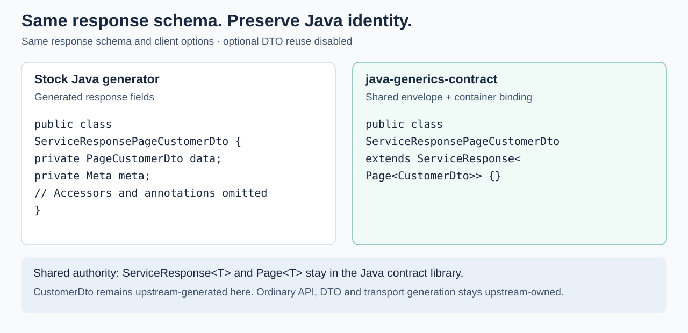

# OpenAPI Generics for Spring Boot

[](https://github.com/blueprint-platform/openapi-generics/actions/workflows/build.yml)
[](https://central.sonatype.com/artifact/io.github.blueprint-platform/openapi-generics-server-starter)
[](https://github.com/blueprint-platform/openapi-generics/releases/latest)
[](LICENSE)

A generated client can match your JSON and still replace your shared Java response types.
**Keep your envelope and container contracts intact in generated Java clients.**
OpenAPI Generics carries their identity through OpenAPI metadata, then specializes OpenAPI Generator's
Java generation to bind concrete payloads back to those contracts.

## The transformation in 30 seconds

Your Spring MVC endpoint returns a generic Java contract:

```java
ResponseEntity<ServiceResponse<Page<CustomerDto>>> getCustomers() { ... }
```

The server starter enriches the projected response schema with its Java identity:

```yaml
# ServiceResponsePageCustomerDto schema
x-api-wrapper: true
x-api-wrapper-type: io.github.blueprintplatform.openapi.generics.contract.envelope.ServiceResponse
x-api-wrapper-datatype: PageCustomerDto
x-data-container: Page
x-data-container-type: io.github.blueprintplatform.openapi.generics.contract.paging.Page
x-data-item: CustomerDto
```

The `java-generics-contract` generator reconstructs:

```java
public class ServiceResponsePageCustomerDto
    extends ServiceResponse<Page<CustomerDto>> {}
```

`ServiceResponse` and `Page` remain shared Java contracts. The generated subclass is a **transport
binding** for that concrete response, not a new application contract. `CustomerDto` can still be an
ordinary generated DTO; reusing an existing DTO is optional through BYOC (Bring Your Own Contract).

Keep generated API/invoker classes and wrapper bindings inside a client library's adapter. Application
code should use its stable interface and shared contract types.

## What the platform owns

| OpenAPI Generics | Upstream OpenAPI Generator / application |
| --- | --- |
| Java contract → OpenAPI metadata projection | Ordinary DTO and API generation |
| Envelope/container identity and generic wrapper reconstruction | HTTP client, authentication and ordinary transport generation |
| Reconstruction metadata validation, template preparation and generated-source normalization | Library/runtime selection, serialization configuration and application architecture |

The generator specializes upstream `JavaClientCodegen`; it is not a fork. OpenAPI remains valid for
other tooling, which can ignore these vendor extensions. The server starter runs during Springdoc
projection and does not intercept requests or change response serialization.

## Choose your envelope; reuse DTOs when needed

**BYOE — Bring Your Own Envelope** is a core ownership choice. Use the built-in `ServiceResponse<T>`
or keep your application's existing `ApiResponse<T>`. For the latter, declare it on the producer:

```yaml
openapi-generics:
  envelope:
    type: com.example.contract.ApiResponse
```

The client reads its identity from `x-api-wrapper-type`; no duplicate client envelope setting is needed.
The shared envelope must be on the client classpath. See [envelope requirements](docs/adoption/server-side-adoption.md#choose-the-envelope).

**BYOC — Bring Your Own Contract** is optional client-side DTO reuse: map a schema name to an existing
Java type instead of generating that model. It does not select the envelope. See [BYOC mappings](docs/adoption/client-side-adoption.md#optional-reuse-existing-dtos-with-byoc).

Built-in containers are `List<T>`, `Set<T>` and platform `Page<T>`. Explicitly registered application
containers use the same metadata-driven reconstruction path.

## Start with your project

Examples target the prepared **1.3.0** release and require its artifacts in your configured repositories;
this checkout has not performed public publication. Repository `includeBuild`/local-install bootstrap
is for development, not a release-consumer prerequisite.

### 1. Publish the contract from your Spring MVC service

Add the server starter alongside your application's Springdoc dependency:

```xml
<dependency>
  <groupId>io.github.blueprint-platform</groupId>
  <artifactId>openapi-generics-server-starter</artifactId>
  <version>1.3.0</version>
</dependency>
```

Keep supported controller signatures unchanged. The built-in envelope needs no configuration;
BYOE and custom containers are producer choices. [Server adoption →](docs/adoption/server-side-adoption.md)

### 2. Generate the client with Maven or Gradle

| Build | Entry point | Next step |
| --- | --- | --- |
| Maven | Inherit `openapi-generics-java-codegen-parent:1.3.0`; configure the official generator with `generatorName=java-generics-contract`. | [Maven setup](docs/adoption/client-side-adoption.md#maven) |
| Gradle | Apply the consumer-selected official OpenAPI Generator (OAG) plugin plus `io.github.blueprint-platform.openapi-generics:1.3.0`; select `java-generics-contract` on a `GenerateTask`. | [Gradle setup](docs/adoption/client-side-adoption.md#gradle) |

Both integrations use the same reconstruction semantics and wire generated sources into Java
compilation. You choose the spec, library, packages and ordinary options, and supply shared-contract
and client-library dependencies. Then place the generated client behind an [application boundary](docs/adoption/client-side-adoption.md#keep-generated-types-behind-the-client-boundary).

## See the proof

| Want to inspect | Maintained example |
| --- | --- |
| Complete web application architecture and real HTTP through consumer → adapter → generated client → producer | [Canonical Gradle Boot 4 stack](samples/gradle/customer-service/README.md) |
| Maven client library/adapter and consumer layering | [Boot 4 Maven client](samples/spring-boot-4/customer-service-client/README.md) |
| Built-in/BYOE shapes, custom containers and generated compilation | [Type coverage](samples/type-coverage/README.md) |
| Multipart, binary and form interoperability | [Transport coverage](samples/transport-coverage/README.md) |



Both excerpts come from compiled output for the same spec and client options.
Optional DTO reuse is disabled: `CustomerDto` remains ordinarily generated in both outputs.
[Proof source and reproduction](docs/images/README.md) · [All samples and run instructions](samples/README.md)

Sample interoperability checks do not transfer ownership of ordinary transport behavior to the platform.

## Compatibility and 1.3.0

Supported lines: **Java 17+**, Spring MVC on **Boot 3.5.x / 4.x**, **OAG 7.x**, Maven and
**Gradle 9.x**. The current OAG reference is **7.27.0**; the Gradle integration has its own minimum
capability edge. Exact references are verification inputs, not consumer-wide pins.
See [compatibility, version roles and scope](docs/compatibility.md).

1.3.0 adds first-class Gradle integration, stricter wrapper metadata validation and broader async/multi-spec
verification. Existing 1.2.x runtime contracts require no migration. [Changelog →](CHANGELOG.md)

## Implementation and further reading

| Module | Role |
| --- | --- |
| [contract](openapi-generics-contract/README.md) | Pure Java shared envelope, paging and metadata types |
| [server starter](openapi-generics-server-starter/README.md) | Spring MVC contract projection |
| [Java codegen](openapi-generics-java-codegen/README.md) | Shared Java reconstruction semantics and wrapper template |
| [Maven parent](openapi-generics-java-codegen-parent/README.md) | Selected-toolchain coherence and Maven generation lifecycle |
| [Gradle plugin](openapi-generics-gradle-plugin/README.md) | Official plugin integration, selected-task wiring and normalization |
| [platform bill of materials (BOM)](openapi-generics-platform-bom/README.md) | Internal platform dependency alignment |

[Documentation hub](docs/index.md) · [Architecture](docs/architecture/architecture.md) ·
[Design rationale](docs/architecture/rationale.md) · [External BYOE adoption example](https://github.com/bsayli/licensing)

## Contributing and license

[Contributing](CONTRIBUTING.md) · [Issues](https://github.com/blueprint-platform/openapi-generics/issues) ·
[Discussions](https://github.com/blueprint-platform/openapi-generics/discussions)

MIT — see [LICENSE](LICENSE). **Barış Saylı** · [GitHub](https://github.com/bsayli)

<!-- Scarf tracking pixel - README -->
