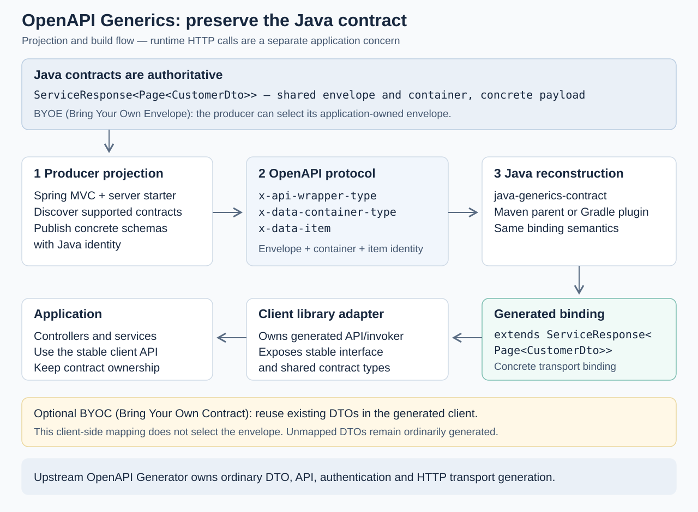

# Architecture: preserve ownership across a projection boundary

The design preserves **Java envelope/container identity**, not just equivalent JSON. A concrete
OpenAPI response is reconstructed as a transport subclass such as
`ServiceResponsePageCustomerDto extends ServiceResponse<Page<CustomerDto>>`. Shared Java contracts
own fields and behavior; generated bindings do not become application contracts.

Use [adoption](../adoption/index.md) for configuration and [rationale](rationale.md) for the design
trade-offs. This page explains how the implementation separates authority, protocol and lifecycle.

## Architecture overview



This is the projection/build flow, not the runtime HTTP call sequence.
[Editable visual sources](../images/README.md).

The OpenAPI document is the protocol between independent projection/reconstruction phases. Codegen
reads no producer controllers and needs no live producer. A client receives the shared Java types
through its own compile/runtime dependencies. Schema metadata identifies them; metadata alone does
not supply a classpath dependency.

| Authority / integration | Owns | Does not own |
| --- | --- | --- |
| Platform `contract` | Built-in ServiceResponse, Page, metadata and error-extension Java types | Spring/runtime integration or every application's DTO/envelope |
| Application contracts | BYOE (Bring Your Own Envelope) envelope, optional shared DTOs and registered containers in that domain | Generated transport implementation |
| Server starter | MVC discovery, supported shape resolution, projection and metadata validation | Request handling or runtime serialization |
| Java codegen | Shared reconstruction semantics, filtering/import resolution and small template overlays | Ordinary upstream API/model/authentication/transport behavior |
| Maven parent / Gradle plugin | Their own template/classpath/source/normalization lifecycles | Reimplementing reconstruction semantics or choosing consumer upstream versions |

## Projection protocol

A page wrapper schema carries:

```yaml
x-api-wrapper: true
x-api-wrapper-type: io.github.blueprintplatform.openapi.generics.contract.envelope.ServiceResponse
x-api-wrapper-datatype: PageCustomerDto
x-data-container: Page
x-data-container-type: io.github.blueprintplatform.openapi.generics.contract.paging.Page
x-data-item: CustomerDto
```

| Extension | Meaning |
| --- | --- |
| `x-api-wrapper` | Boolean wrapper marker |
| `x-api-wrapper-type` | Fully qualified Java envelope identity |
| `x-api-wrapper-datatype` | Projected payload datatype |
| `x-data-container` | Container semantic/simple name used by the binding |
| `x-data-container-type` | Shared container fully qualified Java class name |
| `x-data-item` | Concrete container item type |
| `x-ignore-model` | Retain a schema while suppressing duplicate Java model generation |

`x-ignore-model` belongs on schemas being suppressed, such as projected infrastructure, **not on a
wrapper that must be emitted**. A protocol example must not mark its required wrapper ignored.
Container name/type/item travel together. Built-in List/Set/Page and explicit application containers
follow this model without Page-specific reconstruction branches.

The client derives `x-envelope-import`, `x-envelope-type` and `x-extra-imports` internally. They are not
producer requirements or alternative envelope selectors. Other OpenAPI tooling can ignore the vendor
extensions; equivalent metadata can be supplied in an externally maintained spec without transferring
Java contract ownership to that spec.

## Projection internals

`OpenApiGenericsAutoConfiguration` connects Springdoc customization to
`OpenApiPipelineOrchestrator`. Discovery uses MVC handler mappings, then introspection and policy
resolution determine the supported envelope/payload/container descriptors. Schema processing enriches
concrete wrappers, marks duplicate infrastructure for exclusion and runs the contract guard.

The orchestrator processes an OpenAPI instance idempotently by identity. This prevents repeat
customization of the same document; it is not a global schema cache or a runtime request interceptor.
The starter runs when publishing OpenAPI, not while normal controller responses are serialized.

Envelope/container descriptors are explicit boundaries:

- **BYOE** selects a concrete application class with one generic parameter and one direct field of
  that parameter's type. Usage sites bind containers as the parameter; the envelope itself does not
  define a nested generic payload slot. Envelope identity is selected once on the producer.
- Built-in List/Set arrays and platform Page preserve their distinct Java identities. A Set cannot be
  reconstructed from array shape alone; semantic metadata matters.
- An application container is explicitly registered as a concrete class/record with one type parameter
  and a declared List/Set item property using it directly. Its Java type must also reach the client.
- Supported MVC wrappers are unwrapped before generic projection. Async server signatures therefore
  reuse the same response schema/binding as their synchronous equivalents; they do not create a new
  client-side async contract shape.

[Server adoption](../adoption/server-side-adoption.md) owns practical examples and validation requirements.

## Reconstruction internals

`GenericAwareJavaCodegen` specializes upstream `JavaClientCodegen` through normal hooks:

1. `processOpts` initializes the optional external-model registry.
2. `fromModel` records schemas suppressed by protocol metadata or BYOC (Bring Your Own Contract).
3. `postProcessModels` filters ignored entries, validates wrapper metadata and resolves external payload
   imports plus envelope identity.
4. `postProcessAllModels` removes ignored entries from the global graph, delegates upstream processing
   and cleans dangling ignored model imports.
5. Upstream templates continue generating ordinary models/APIs/supporting files; the platform wrapper
   partial renders the shared generic superclass for marked wrappers.

**BYOC is optional DTO reuse**, expressed by client schema-name → fully qualified Java class name mappings. It neither selects the
envelope nor means every ordinary model must be shared. Without a mapping, DTO generation stays
upstream-owned. The external Java dependency is still the consumer's responsibility.

The generated wrapper has concrete generic parameters for transport/deserialization. A reusable client
library configures the generated API/invoker and exposes a stable adapter API; controllers/services
should consume that API and shared contracts, mapping ordinary generated DTOs where their application
boundary requires it. Focused codegen harnesses may inspect generated types directly as test subjects.

## Template ownership and documentation

Upstream `Java/model.mustache` owns ordinary enum/oneOf/POJO dispatch. Integrations discover/extract that
selected upstream resource, patch its wrapper dispatch and apply the small codegen overlay. Required
anchor drift or missing/ambiguous template ownership fails explicitly rather than guessing a replacement.
The platform does not maintain a wholesale Java template fork.

The RestClient-specific **model documentation** overlay dispatches only marked wrapper docs to a small
partial that reuses the Java wrapper fragment. It shows generic/shared identities without links to
suppressed/reused local model docs. Ordinary RestClient model/enum docs delegate to upstream partials;
other libraries retain their documentation templates. API documentation snippets and generated test
scaffolding remain upstream-owned. Doc display does not modify model graph, producer metadata or Java
binding semantics.

## Build integrations: same semantics, different lifecycles

| Concern | Maven parent | Gradle plugin |
| --- | --- | --- |
| Official tool/version | Consumer `openapi-generator.version` aligns official plugin/core/generator | Consumer applies/versions official plugin; platform integrates via `withPlugin` |
| Upstream template origin | Extract from the selected OpenAPI Generator (OAG) artifact | Discover from the running official plugin classloader; no independently resolved upstream template runtime |
| Platform codegen | Same platform release as parent | Same platform release as plugin manifest; conflicting direct declarations fail |
| Selection | Consumer generator execution configuration | Only `GenerateTask` instances selecting `java-generics-contract`, including custom/multiple tasks |
| Sources / compilation | Default build-helper root plus official execution source registration | Java plugin registers each selected task's effective output/sourceFolder and compilation dependency |
| Normalization | Parent `process-sources` hygiene over configured includes | Selected generation task's final action, before output snapshots |

Maven custom outputs need a separate check that normalization includes cover them; compilation alone
does not prove this. Gradle default/custom tasks do not inherit one another's worker classpath, so
selected-task wiring is explicit. Non-selected tasks retain consumer template settings; setting an
absent provider can erase those settings and is intentionally avoided.

Gradle source registration is installed outside `GenerateTask.configureEach` mutation scope. Effective
`sourceFolder` follows upstream config binding and option precedence (`configOptions`, task
`additionalProperties`, config-file values, default). Config-file contents are tracked; source root
providers avoid output dependencies that would introduce task cycles. Execution actions capture state
during configuration and do not look up Project/task extensions at execution time. These choices
support configuration-cache replay; they are not a general Isolated Projects or cache-relocation guarantee.

The internal bill of materials (BOM) aligns platform dependencies, not consumer framework/tool versions. Exact current,
minimum and negative references live in [compatibility](../compatibility.md); build wrappers and sample
pins must not become universal consumer constraints.

## Validation and evidence

Configured envelope/container invariants, inconsistent wrapper metadata, reconstruction errors and
required template drift fail explicitly at the owning layer. This does not erase intentional behavior:
unsupported/unresolved introspection can return `Optional.empty`, invalid optional BYOC registrations
can warn-and-skip, and missing normalization directories can be no-ops. Treat successful startup or
absence of an exception as insufficient proof that every intended contract was projected.

| Evidence | What it establishes |
| --- | --- |
| Unit/context tests | Deterministic descriptor, metadata, filtering/import and orchestration behavior |
| Fixture-based TestKit | Gradle integration wiring, source/classpath and configuration-cache behavior with fixtures |
| Real codegen / generated compilation | Actual template use, binding/source compatibility and exercised cache paths |
| Application runtime tests | The specific real HTTP/deserialization paths executed |
| Committed spec checks | Reviewed projection stability and visible drift |

Canonical Gradle acceptance calls real consumer endpoints through controller/service/remote client and
adapter to the producer. Type/transport harnesses have different runtime coverage; their README/test
bindings specify what actually executes. Transport interoperability checks do not make multipart,
binary or form serialization platform-owned.

## Scope and navigation

Published platform code targets Java 17+; current projection is Spring MVC, reconstruction is Java,
and integrations are Maven/Gradle. Arbitrary nested generic graphs, unregistered container inference,
WebFlux and custom component names differing from Java simple names are outside supported scope.
See [compatibility](../compatibility.md) for the authoritative support/reference distinction.

- [Java contract module](https://github.com/blueprint-platform/openapi-generics/blob/main/openapi-generics-contract/README.md)
- [Server starter](https://github.com/blueprint-platform/openapi-generics/blob/main/openapi-generics-server-starter/README.md)
- [Shared codegen](https://github.com/blueprint-platform/openapi-generics/blob/main/openapi-generics-java-codegen/README.md)
- [Maven parent](https://github.com/blueprint-platform/openapi-generics/blob/main/openapi-generics-java-codegen-parent/README.md)
- [Gradle plugin](https://github.com/blueprint-platform/openapi-generics/blob/main/openapi-generics-gradle-plugin/README.md)
- [Internal BOM](https://github.com/blueprint-platform/openapi-generics/blob/main/openapi-generics-platform-bom/README.md)
